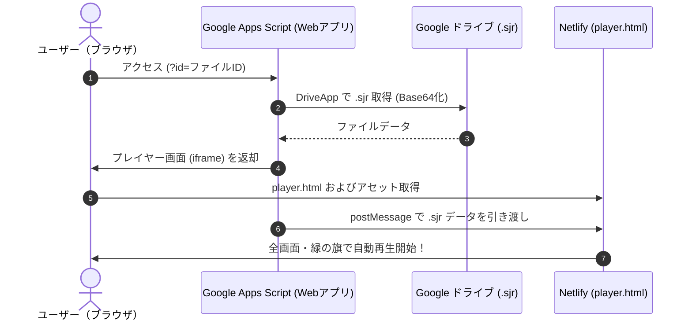

# ScratchJr Web Player (Netlify + Google Apps Script)

Google ドライブ内に保存されている ScratchJr プロジェクトファイル（`.sjr`）を、ブラウザ上で全画面・自動再生できる Web プレイヤーシステムです。

---

## 構成概要

本システムは、**Netlify（静的アセット配信）** と **Google Apps Script（Google ドライブファイル連携）** の 2 つを連携させて動作します。



---

## ファイル構成

* `player.html` - ScratchJr 自動再生プレイヤー画面（Netlify 側で配信）
* `_headers` / `netlify.toml` - Netlify 用セキュリティヘッダー（iframe 埋め込み・CORS 許可）
* `gas/Code.gs` - Google Apps Script 側コード（Google ドライブから `.sjr` を取得してプレイヤーを表示）
* `app.bundle.js` / `assets/` / `svglibrary/` / `sounds/` - ScratchJr のランタイム・素材アセット群

---

## セットアップ手順

### 1. Netlify へのデプロイ
1. [Netlify](https://app.netlify.com/) で「Add new site」>「Import an existing project」を選択。
2. GitHub の `scratchjr-player` リポジトリを選択してデプロイします。
3. 発行された URL を確認します（例: `https://xxxx.netlify.app`）。

### 2. Google Apps Script (GAS) のセットアップ
1. [Google Apps Script](https://script.google.com/) で新しいプロジェクトを作成します。
2. `gas/Code.gs` の内容をそのまま貼り付けます。
3. 15 行目の `PLAYER_APP_URL` を確認します（すでに設定済みです）：
   ```javascript
   var PLAYER_APP_URL = "https://scratchjr-player.netlify.app/player.html";
   ```
4. 右上の **「デプロイ」 > 「新しいデプロイ」** を選択：
   * 種類: **ウェブアプリ**
   * 次のユーザーとして実行: **自分**
   * アクセスできるユーザー: **全員**
5. 発行された **「ウェブアプリの URL」** を取得します。

---

## 使い方（再生方法）

Google ドライブ上の `.sjr` ファイルの**ファイル ID** を取得し、以下の URL 形式でブラウザで開きます：

```
https://script.google.com/macros/s/XXXXX/exec?id=【GoogleドライブのファイルID】
```

### URL オプション

| パラメータ | 説明 |
| :--- | :--- |
| `?id=FILE_ID` | 再生する `.sjr` のファイル ID（必須） |
| `&autoPlay=0` | 緑の旗の自動スタートを行わず、停止状態で開く |
